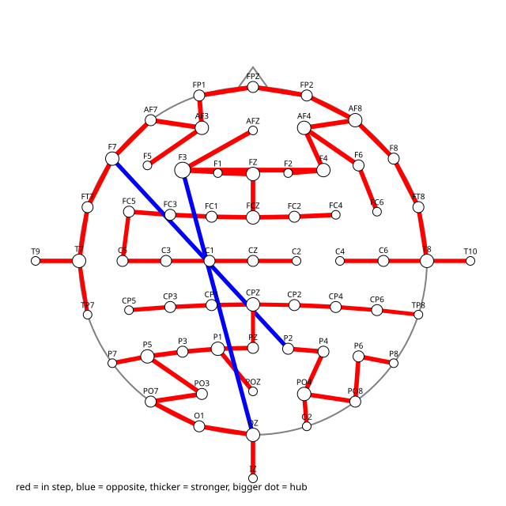

# Brain Connectivity Analyser

This brain connectivity analyser reads EEG recordings from PhysioNet dataset (64 electrodes), cleans the signal, and checks how strongly every pair of electrodes is connected using coherency, which we compute with FFT. This gives us a graph where electrodes are nodes and connection strengths are edge weights. We use Kruskal and Prim algorithm to find the maximum spanning tree (MST), which keeps the strongest edges that still connect all the electrodes, and Floyd-Warshall to find shortest paths between all pairs, which we use to calculate global efficiency. Finally the program visualizes the head with the nodes.

- **Graph:** electrodes are nodes, connection strength between two electrodes is the edge weight.
- **Greedy:** maximum spanning tree (Kruskal with DSU, and Prim) to keep the strongest edges that connect all electrodes.
- **Dynamic programming:** Floyd–Warshall all-pairs shortest paths, then global efficiency.
- **Divide and conquer:** our own FFT, used to filter the signal and compute coherency.

## Files

| File | What is inside |
| --- | --- |
| `brain.h` | the shared structs and the list of functions |
| `edf.cpp` | reading the EEG file and `brodmann_map.csv` |
| `signal.cpp` | FFT, filtering, cutting into epochs, coherency (builds the graph) |
| `paths.cpp` | distance = 1 / strength, Floyd–Warshall, global efficiency |
| `mst.cpp` | DSU, Kruskal, Prim, degree |
| `main.cpp` | runs everything and prints the results |
| `visualize.cpp` | draws the head picture (an svg file you open in a browser) |
| `brodmann_map.csv` | for each electrode: the Brodmann area under it, its brain region, and its x,y position for the picture |

## Build and run

```
mingw32-make
./brain data/S001R01.edf eyes_open
./brain data/S001R02.edf eyes_closed
```

The third argument changes the noise limit (default 400 µV), for example `./brain data/S001R01.edf eyes_open 300`.

Data: PhysioNet EEG Motor Movement/Imagery dataset, subject 1, run 1 (eyes open) and run 2 (eyes closed):
https://physionet.org/files/eegmmidb/1.0.0/S001/

## Demo

`./brain data/S001R02.edf eyes_closed`

```
loaded data/S001R02.edf: 64 channels, 160 Hz, 61 seconds
epochs kept: 20 of 29

mst: 63 edges
total strength: kruskal 58.4007, prim 58.4007
opposite phase edges: 2
hubs:
  F3 (BA 9, Frontal) degree 4
  FCZ (BA 6, Sensorimotor) degree 3
  CPZ (BA 5, Parietal) degree 3
  AF3 (BA 9, Frontal) degree 3
  AF4 (BA 9, Frontal) degree 3

global efficiency: 0.587894

saved head_eyes_closed.svg
```

What it means:

- **epochs kept:** 20 of the 29 two-second chunks were clean. The other 9 had blinks or movement and were dropped.
- **mst: 63 edges:** the MST connects all 64 electrodes with the fewest edges possible (64 − 1 = 63).
- **total strength:** the sum of the MST's edge weights. Kruskal and Prim give the same number, so both algorithms agree.
- **opposite phase edges:** 2 MST edges link electrodes whose signals move in opposite directions. The other 61 move in step.
- **hubs:** the electrodes with the most MST edges, with the Brodmann area and brain region under each one.
- **global efficiency:** how easily information can travel between any two electrodes (higher means shorter paths). Eyes open gives 0.473, so for this subject the alpha network is more efficient with eyes closed, which is when the alpha rhythm is strongest.

The picture `head_eyes_closed.svg` shows the MST on the head (nose at the top). Red lines are in step, blue lines are opposite, thicker lines are stronger, and bigger dots are hubs.



## Steps

1. Read the EDF file (64 channels, 160 Hz).
2. Band-pass 1–40 Hz to remove drift and noise, then subtract the average of all channels (common average reference).
3. Cut into 2 second epochs and drop noisy ones (peak to peak above the limit).
4. Coherency for every pair in the alpha band (8–13 Hz), computed with our FFT. Each pair gets one complex number that stores two things at once: its size (0 to 1) is the edge weight, and its angle is the direction of the timing, meaning in step or opposite. In the picture, red means in step and blue means opposite.
5. MST, hubs, Floyd–Warshall, global efficiency, picture `head_<name>.svg`.
